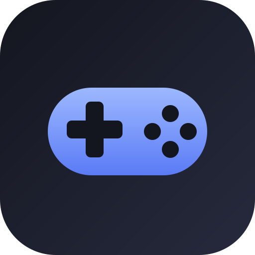
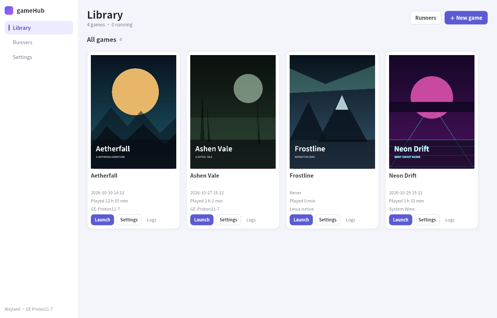
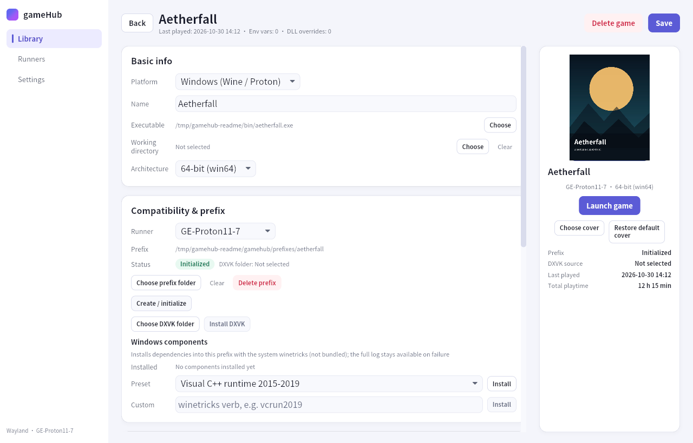
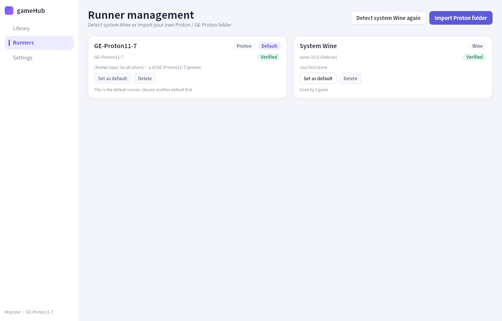
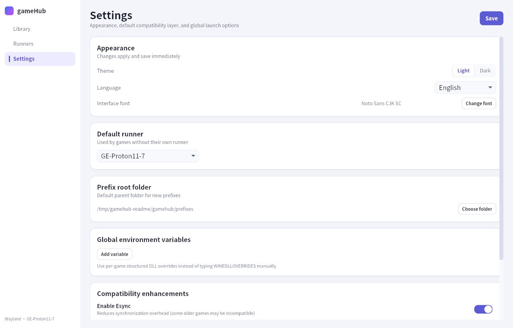
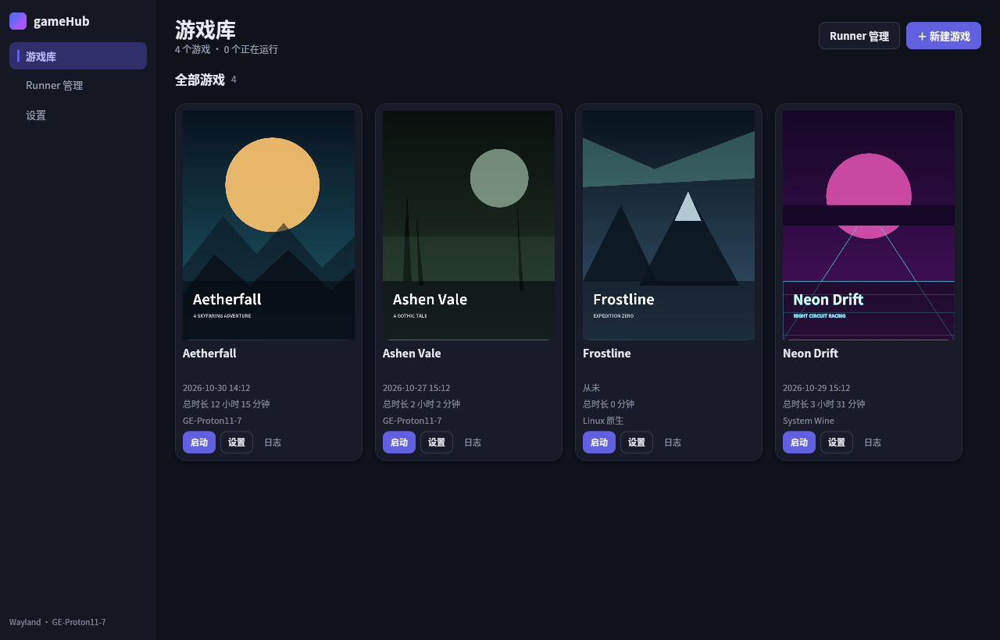

<p align="center">
  
</p>

<h1 align="center">gameHub</h1>

<p align="center">
  <b>Your Linux game library, entirely offline.</b><br />
  A native Rust launcher for Windows and Linux games. Bring your own Wine or Proton,
  keep full control of your prefixes, and never phone home.
</p>

<p align="center">
  <a href="https://github.com/Spinach5/gamehub/releases/latest"></a>
  <a href="LICENSE"></a>
  
  
  
</p>

<p align="center">
  <a href="README.zh-CN.md">简体中文</a> · <b>English</b>
</p>

<p align="center">
  <a href="#features">Features</a> ·
  <a href="#screenshots">Screenshots</a> ·
  <a href="#installation">Installation</a> ·
  <a href="#quick-start">Quick start</a> ·
  <a href="#build-from-source">Build</a> ·
  <a href="#architecture">Architecture</a> ·
  <a href="#faq">FAQ</a> ·
  <a href="#documentation">Docs</a>
</p>

---



> gameHub running with demo data on GNOME Wayland (XWayland), English and light theme.
> The same interface ships in Simplified Chinese with a dark theme.

**gameHub** is a desktop launcher for games you already own. Point it at a local
`.exe` or a native Linux executable, choose a Wine or Proton runner, and play.
There is no store, no account, no embedded browser, and no background service.
Runners, prefixes, DXVK builds, and winetricks components stay exactly where you
put them.

> **Status:** v0.9.0 — early but usable. Linux only. Windows and macOS are out of scope.

## Features

| Area | What you get |
| --- | --- |
| **Two platforms** | Windows games through Wine / Proton, and native Linux executables launched directly. |
| **Library** | Cover grid, custom covers, last-played time, cumulative playtime, live running state, and per-game logs. |
| **Runners** | Detect system Wine, import a Proton / GE-Proton folder from disk, verify it, set a global default or pick per game. |
| **Prefixes** | Per-game or shared Wine prefixes, `wineboot` initialization, architecture detection, custom prefix root, and reference-safe deletion. |
| **Graphics** | Inject a DXVK build you provide, optionally keep DXVK-NVAPI up to date, and express DLL overrides structurally instead of hand-writing `WINEDLLOVERRIDES`. |
| **Tuning** | Global and per-game environment variables, launch arguments, Esync / Fsync toggles, and a MangoHud switch. |
| **Display** | Monitor selection, resolution and refresh rate through gamescope, fullscreen, gamescope auto/forced/off, and temporary X11/XWayland primary switching. |
| **Components** | Install Windows dependencies through system `winetricks`, with presets, custom verbs, streamed output, and cancellation. |
| **Interface** | Simplified Chinese and English, light and dark themes, and an interface-font picker that can list only CJK-capable families. |
| **Offline** | No HTTP client, no update checker, no telemetry, no crash reporting. Everything is local. |

## Screenshots

<p align="center">
  
  
</p>
<p align="center">
  
  
</p>

## Installation

Prebuilt packages for **x86_64** and **aarch64** are attached to every
[GitHub release](https://github.com/Spinach5/gamehub/releases/latest).
The project is also mirrored on [Gitee](https://gitee.com/dzh258/gamehub).

| Format | Install |
| --- | --- |
| **AppImage** | `chmod +x gamehub_0.9.0_x86_64.AppImage && ./gamehub_0.9.0_x86_64.AppImage` |
| **Debian / Ubuntu** | `sudo apt install ./gamehub_0.9.0_x86_64.deb` |
| **Fedora / RHEL** | `sudo dnf install ./gamehub_0.9.0_x86_64.rpm` |
| **Arch Linux** | `sudo pacman -U ./gamehub_0.9.0_x86_64.pkg.tar.zst` |
| **Portable tarball** | `tar -xJf gamehub_0.9.0_linux_x86_64.tar.xz && ./gamehub_0.9.0_linux_x86_64/gamehub` |

If FUSE is unavailable, run the AppImage with
`--appimage-extract-and-run`. Release filenames use `x86_64` / `aarch64`; replace
the suffix for ARM packages.

### Runtime dependencies

gameHub does **not** bundle Wine, Proton, DXVK, MangoHud, winetricks, or fonts.

| Dependency | Required | Purpose |
| --- | --- | --- |
| X11 or Wayland session | Yes | XWayland is recommended for Wine / Proton window placement. |
| Wine or a Proton / GE-Proton build | Yes, for Windows games | Detected from `PATH` or imported as a folder. |
| `xdg-desktop-portal` | Yes | Native file dialogs through D-Bus (no GTK dependency). |
| A CJK-capable font | Yes | Defaults to `Noto Sans CJK SC`; any installed family can be chosen in Settings. |
| A Vulkan driver | For DXVK | Provided by your GPU driver. |
| `gamescope` | Optional | Resolution, refresh-rate, and per-game window control. |
| `MangoHud` | Optional | Performance overlay. |
| `winetricks` | Optional | Installing Windows components into a prefix. |
| DXVK / DXVK-NVAPI folder | Optional | Extracted release directory containing `x64` / `x32` DLLs. |

## Quick start

1. **Install a runner.** Open **Runners**, detect system Wine, or import a
   Proton / GE-Proton folder. Set one as the default if you like.
2. **Add a game.** Choose **New game**, pick Windows or Linux native, then select
   the executable.
3. **Create a prefix.** For Windows games, choose a prefix directory and press
   **Create / initialize**. Shared prefixes are allowed; gameHub detects
   architecture mismatches before launch.
4. **Tune it.** Optionally install DXVK from your own folder, add DLL overrides,
   components, environment variables, launch arguments, a monitor, or gamescope
   settings.
5. **Play.** Press **Launch**. Logs stream to the **Logs** page and to
   `logs/games/<game-id>.log`; **Stop** ends the process group and, for Windows
   games, cleans up the Wine prefix.

## Build from source

Requirements: Rust **1.85+** (edition 2024), a C toolchain, `pkg-config`, and the
X11 / Wayland development headers.

```bash
# Debian / Ubuntu
sudo apt install build-essential pkg-config \
  libx11-dev libxcb1-dev libxcb-shm0-dev libxcb-render0-dev \
  libxcb-randr0-dev libxcb-xfixes0-dev libxcb-shape0-dev libxcb-xkb-dev \
  libxkbcommon-dev libxkbcommon-x11-dev libwayland-dev libvulkan-dev

# Fedora
sudo dnf install gcc gcc-c++ make pkgconf-pkg-config \
  libX11-devel libxcb-devel libxkbcommon-devel libxkbcommon-x11-devel \
  wayland-devel vulkan-loader-devel

# Arch Linux
sudo pacman -S --needed base-devel pkgconf libx11 libxcb \
  libxkbcommon libxkbcommon-x11 wayland vulkan-icd-loader
```

```bash
git clone https://github.com/Spinach5/gamehub.git
cd gamehub
cargo build --release --locked
./target/release/gamehub
```

For development, run the UI crate directly:

```bash
cargo run -p ui
```

## Architecture

gameHub is a Cargo workspace with eight crates and a strictly one-way dependency
graph. The UI contains no database or process logic; storage, runners, prefixes,
display, and launches are all driven through the application layer.

```
crates/
├── launcher-core   Types, serde contracts, path resolution, logging
├── storage         SQLite schema, migrations, repositories
├── runner-wine     Wine detection, Proton validation, wine context, stop
├── prefix          Prefix status/init, DXVK, DXVK-NVAPI, winetricks
├── display         Session detection, xrandr, Mutter primary, gamescope, MangoHud
├── launch          Runner resolution, validation, env, launch plan, spawn
├── application     Use cases, unified errors, running-process registry
└── ui              Iced state machine, views, theme, i18n, fonts
```

```
ui ──> application ──> launch ──> prefix, display, runner-wine, storage
                 └───> prefix, display, runner-wine, storage, launcher-core
```

The stack is deliberately small: **Rust 2024**, **Iced 0.13** for the UI,
**rusqlite** with bundled SQLite, **tokio** for async work, **rfd** for portal
file dialogs, and **zbus** for GNOME primary-monitor switching. Workspace lints
forbid `unsafe` code.

## Data locations

Everything lives under `$XDG_DATA_HOME/gamehub`, falling back to
`~/.local/share/gamehub`:

| Path | Contents |
| --- | --- |
| `gamehub.db` | SQLite database (library, runners, settings). |
| `logs/` | Daily application logs and per-game launch logs. |
| `prefixes/` | Default prefix root; can be overridden in Settings. |
| `covers/` | Copies of user-selected cover images. |
| `steam-compat-client/` | `STEAM_COMPAT_CLIENT_INSTALL_PATH` used by Proton. |

Deleting a game removes its configuration, logs, and cover. Prefixes are deleted
only when no other game references them.

## Offline by design

gameHub is built for machines that are offline, air-gapped, or simply private:

- no HTTP client is linked into the binary;
- no update checks, usage analytics, crash uploads, or account system;
- importing a runner, DXVK build, cover, or game only reads local files;
- file dialogs use the desktop portal over D-Bus, not a network service;
- the v2 acceptance run traced a real launch with `strace` and observed no
  `AF_INET` / `AF_INET6` sockets.

The only network traffic is your own download of gameHub and of the components
you choose to install.

## FAQ

**Does gameHub download Wine, Proton, DXVK, or components?**
No. It only consumes files already on disk. Install Wine through your distro,
import a Proton / GE-Proton folder, and point the game at an extracted DXVK
directory.

**Can I use the Proton build that ships with Steam?**
Yes. Import the tool folder under
`~/.local/share/Steam/compatibilitytools.d/` (any directory containing the
`proton` script works). gameHub validates the layout before accepting it.

**Where are my save files?**
Inside each game's Wine prefix, under `drive_c`, exactly as in a normal Wine
installation. gameHub never rewrites game saves. Back up the prefix to preserve
them.

**Why do file dialogs fail to open?**
`rfd` talks to `xdg-desktop-portal`, so a portal service and a desktop backend
(GNOME, KDE, etc.) must be installed. gameHub deliberately does not link GTK.

**Does it work on Wayland?**
Yes. Native Linux games run natively. For Wine / Proton, XWayland gives the most
reliable monitor selection; pure Wayland cannot guarantee window placement.

**How do I update?**
Install the newer package over the old one and keep your data directory.
Database migrations from v1 through v4 run automatically at startup.

## Known limitations

- Without gamescope on X11, gameHub does not change resolution or refresh rate;
  it only sets `__GL_SYNC_DISPLAY_DEVICE`.
- On native Wayland, a Wine window cannot always be forced onto the selected
  monitor. gameHub uses the X11/XWayland primary-monitor path when available.
- Custom cover images are drawn with square corners (an Iced 0.13 limitation);
  generated gradient covers are rounded.
- Paths stored in the database must be valid UTF-8. Non-UTF-8 paths are rejected
  on import.
- Native Linux games have no `wineserver` fallback. If a game daemonizes out of
  its process group, **Stop** may not reach it.
- gameHub is a launcher, not a storefront: no downloads, metadata scraping,
  achievements, cloud saves, or Steam integration.
- Deleting a game or prefix is immediate and permanent; there is no trash.

## Development

```bash
cargo fmt --all -- --check
cargo clippy --workspace --all-targets -- -D warnings
cargo test --workspace
```

At v0.9.0 the suite reports **329 passed, 0 failed, 2 ignored**. Real Wine and
GE-Proton launches, display switching, DXVK injection, and stop behavior are
exercised during manual acceptance; see [`docs/acceptance.md`](docs/acceptance.md).

Contributions are welcome. Keep changes focused, add tests for new behavior, and
run the three checks above before opening a pull request. Design notes, specs,
and implementation history live in [`docs/`](docs/).

## Documentation

| Document | Contents |
| --- | --- |
| [`docs/specs/00-overview.md`](docs/specs/00-overview.md) | Product boundary, architecture, crate responsibilities. |
| [`docs/plan.md`](docs/plan.md) | Implementation phases and entry points. |
| [`docs/acceptance.md`](docs/acceptance.md) | Acceptance evidence and known gaps. |
| [`docs/i18n.md`](docs/i18n.md) | Maintaining the Chinese and English catalogs. |
| [`CHANGELOG.md`](CHANGELOG.md) | Per-release changes, deviations, and verification. |

## License

gameHub is released under the [MIT License](LICENSE).

## Disclaimer

gameHub is an independent project and is not affiliated with Valve, CodeWeavers,
the Wine project, Proton, DXVK, MangoHud, or winetricks. Game titles, cover art,
and trademarks belong to their respective owners. Screenshots use fictional demo
titles created for this README.
