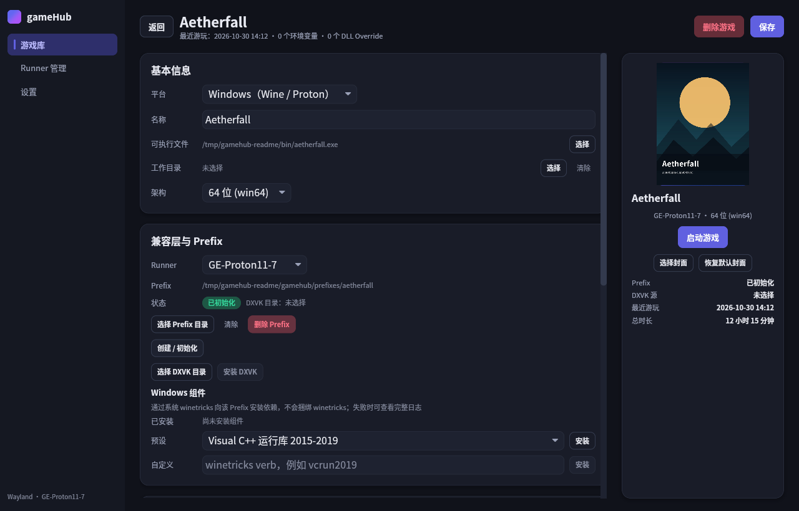
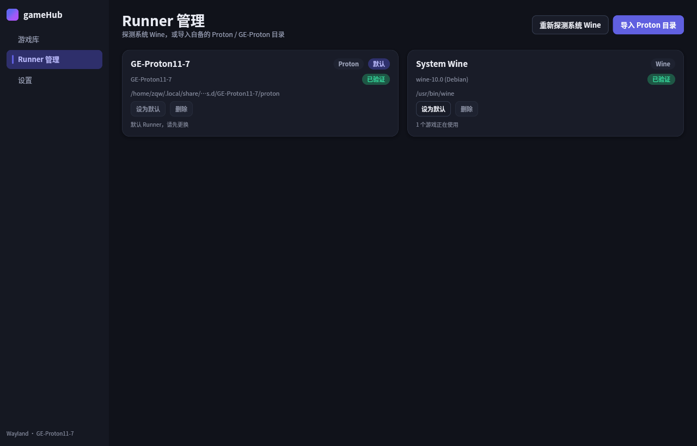
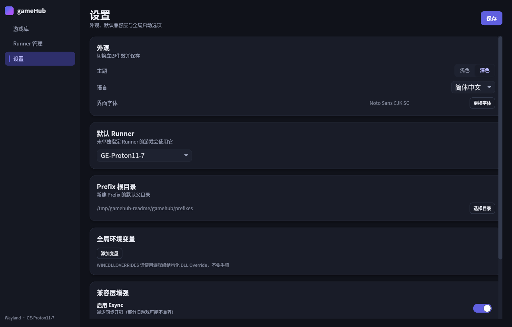

<p align="center">
  
</p>

<h1 align="center">gameHub</h1>

<p align="center">
  <b>完全离线的 Linux 游戏库。</b><br />
  用 Rust 编写的原生启动器，支持 Windows 与 Linux 游戏。自带 Wine / Proton，
  完全掌控 Prefix，运行期不发起任何网络请求。
</p>

<p align="center">
  <a href="https://github.com/Spinach5/gamehub/releases/latest"></a>
  <a href="LICENSE"></a>
  
  
  
</p>

<p align="center">
  <b>简体中文</b> · <a href="README.md">English</a>
</p>

<p align="center">
  <a href="#功能">功能</a> ·
  <a href="#界面截图">界面截图</a> ·
  <a href="#安装">安装</a> ·
  <a href="#快速开始">快速开始</a> ·
  <a href="#从源码构建">构建</a> ·
  <a href="#架构">架构</a> ·
  <a href="#常见问题">FAQ</a> ·
  <a href="#文档">文档</a>
</p>

---


> gameHub 在 GNOME Wayland（XWayland）下运行，使用示例数据、简体中文与深色主题。
> 同一套界面也提供英文与浅色主题。

**gameHub** 是给「已经拥有游戏」的玩家准备的桌面启动器。指向本地 `.exe` 或
Linux 原生可执行文件，选择 Wine / Proton runner，即可开始游戏。没有商店、没有
账号、没有内嵌浏览器，也没有后台服务。Runner、Prefix、DXVK 与 winetricks
组件始终留在你放置的位置。

> **状态：** v0.9.0，可用但仍在早期。仅支持 Linux，Windows 与 macOS 不在范围内。

## 功能

| 模块 | 说明 |
| --- | --- |
| **双平台** | Windows 游戏通过 Wine / Proton 运行，Linux 原生可执行文件直接启动。 |
| **游戏库** | 封面网格、自定义封面、最近游玩、累计时长、实时运行状态与单游戏日志。 |
| **Runner** | 探测系统 Wine，从磁盘导入 Proton / GE-Proton 目录并校验，可设全局默认或按游戏选择。 |
| **Prefix** | 每游戏独立或共享 Prefix、`wineboot` 初始化、架构检测、自定义根目录、带引用检查的删除。 |
| **图形** | 注入你提供的 DXVK、可选自动维护 DXVK-NVAPI、结构化 DLL Override，无需手写 `WINEDLLOVERRIDES`。 |
| **调优** | 全局与单游戏环境变量、启动参数、Esync / Fsync 开关、MangoHud 开关。 |
| **显示** | 显示器选择、经 gamescope 设置分辨率与刷新率、全屏、gamescope 自动/强制/关闭、X11/XWayland 临时主屏切换。 |
| **组件** | 通过系统 `winetricks` 安装 Windows 依赖，支持预设、自定义 verb、流式日志与取消。 |
| **界面** | 简体中文 / English、浅色 / 深色主题、可筛选「仅显示支持中文」的界面字体选择器。 |
| **离线** | 无 HTTP 客户端、无更新检查、无遥测、无崩溃上报，全部本地完成。 |

## 界面截图

<p align="center">
  
  
</p>
<p align="center">
  
  
</p>

## 安装

每次 [GitHub Release](https://github.com/Spinach5/gamehub/releases/latest)
都会提供 **x86_64** 与 **aarch64** 的预编译包。
项目同时镜像在 [Gitee](https://gitee.com/dzh258/gamehub)。

| 格式 | 安装方式 |
| --- | --- |
| **AppImage** | `chmod +x gamehub_0.9.0_x86_64.AppImage && ./gamehub_0.9.0_x86_64.AppImage` |
| **Debian / Ubuntu** | `sudo apt install ./gamehub_0.9.0_x86_64.deb` |
| **Fedora / RHEL** | `sudo dnf install ./gamehub_0.9.0_x86_64.rpm` |
| **Arch Linux** | `sudo pacman -U ./gamehub_0.9.0_x86_64.pkg.tar.zst` |
| **免安装压缩包** | `tar -xJf gamehub_0.9.0_linux_x86_64.tar.xz && ./gamehub_0.9.0_linux_x86_64/gamehub` |

如果系统没有 FUSE，可为 AppImage 追加 `--appimage-extract-and-run`。
发布文件名统一使用 `x86_64` / `aarch64` 标签，ARM 包请替换后缀。

### 运行期依赖

gameHub **不捆绑** Wine、Proton、DXVK、MangoHud、winetricks 或字体。

| 依赖 | 是否必需 | 用途 |
| --- | --- | --- |
| X11 或 Wayland 会话 | 是 | Wine / Proton 的窗口定位建议使用 XWayland。 |
| Wine 或 Proton / GE-Proton | Windows 游戏必需 | 从 `PATH` 探测，或以目录形式导入。 |
| `xdg-desktop-portal` | 是 | 通过 D-Bus 调用原生文件对话框（不依赖 GTK）。 |
| 支持中文的字体 | 是 | 默认 `Noto Sans CJK SC`，可在设置中换成任意已安装字体。 |
| Vulkan 驱动 | 使用 DXVK 时需要 | 由显卡驱动提供。 |
| `gamescope` | 可选 | 分辨率、刷新率与单游戏窗口控制。 |
| `MangoHud` | 可选 | 性能覆盖层。 |
| `winetricks` | 可选 | 向 Prefix 安装 Windows 组件。 |
| DXVK / DXVK-NVAPI 目录 | 可选 | 解压后的发布目录，需包含 `x64` / `x32` 的 DLL。 |

## 快速开始

1. **准备 Runner。** 打开 **Runner 管理**，探测系统 Wine，或导入
   Proton / GE-Proton 目录。需要时设为默认。
2. **添加游戏。** 点击 **新建游戏**，选择 Windows 或 Linux 原生，再选择可执行文件。
3. **创建 Prefix。** Windows 游戏选择 Prefix 目录并点击 **创建 / 初始化**。
   多个游戏可共享 Prefix；架构不一致会在启动前提示。
4. **按需调整。** 可注入自己的 DXVK、添加 DLL Override、安装组件、设置环境变量、
   启动参数、显示器或 gamescope。
5. **开始游戏。** 点击 **启动**。日志会实时出现在 **日志** 页面并写入
   `logs/games/<游戏 ID>.log`；**停止** 会结束进程组，Windows 游戏还会清理
   Wine Prefix。

## 从源码构建

需要 Rust **1.85+**（edition 2024）、C 工具链、`pkg-config`，以及 X11 / Wayland
开发头文件。

```bash
# Debian / Ubuntu
sudo apt install build-essential pkg-config \
  libx11-dev libxcb1-dev libxcb-shm0-dev libxcb-render0-dev \
  libxcb-randr0-dev libxcb-xfixes0-dev libxcb-shape0-dev libxcb-xkb-dev \
  libxkbcommon-dev libxkbcommon-x11-dev libwayland-dev libvulkan-dev

# Fedora
sudo dnf install gcc gcc-c++ make pkgconf-pkg-config \
  libX11-devel libxcb-devel libxkbcommon-devel libxkbcommon-x11-devel \
  wayland-devel vulkan-loader-devel

# Arch Linux
sudo pacman -S --needed base-devel pkgconf libx11 libxcb \
  libxkbcommon libxkbcommon-x11 wayland vulkan-icd-loader
```

```bash
git clone https://github.com/Spinach5/gamehub.git
cd gamehub
cargo build --release --locked
./target/release/gamehub
```

开发时可直接运行 UI crate：

```bash
cargo run -p ui
```

## 架构

gameHub 是一个包含 8 个 crate 的 Cargo workspace，依赖方向严格单向。UI 不包含
数据库或进程逻辑；存储、Runner、Prefix、显示与启动都由应用层统一驱动。

```
crates/
├── launcher-core   类型、serde 契约、路径计算、日志
├── storage         SQLite schema、迁移、仓储
├── runner-wine     Wine 探测、Proton 校验、Wine 上下文、停止
├── prefix          Prefix 状态/初始化、DXVK、DXVK-NVAPI、winetricks
├── display         会话检测、xrandr、Mutter 主屏、gamescope、MangoHud
├── launch          Runner 解析、启动校验、环境合成、启动计划、spawn
├── application     用例编排、统一错误、运行中进程表
└── ui              Iced 状态机、视图、主题、i18n、字体
```

```
ui ──> application ──> launch ──> prefix, display, runner-wine, storage
                 └───> prefix, display, runner-wine, storage, launcher-core
```

技术栈刻意保持精简：**Rust 2024**、**Iced 0.13**、内置 SQLite 的
**rusqlite**、异步任务用 **tokio**、文件对话框用 **rfd**（走 portal）、
GNOME 主屏切换用 **zbus**。workspace lint 禁止 `unsafe` 代码。

## 数据目录

所有数据位于 `$XDG_DATA_HOME/gamehub`，未设置时回退到
`~/.local/share/gamehub`：

| 路径 | 内容 |
| --- | --- |
| `gamehub.db` | SQLite 数据库（游戏库、Runner、设置）。 |
| `logs/` | 每日应用日志与单游戏启动日志。 |
| `prefixes/` | 默认 Prefix 根目录，可在设置中覆盖。 |
| `covers/` | 用户选择的封面图片副本。 |
| `steam-compat-client/` | Proton 使用的 `STEAM_COMPAT_CLIENT_INSTALL_PATH`。 |

删除游戏会同时删除其配置、日志与封面。Prefix 只有在没有其他游戏引用时才能删除。

## 离线设计

gameHub 面向离线、隔离网络或单纯注重隐私的机器：

- 二进制中不链接任何 HTTP 客户端；
- 没有更新检查、使用统计、崩溃上传或账号系统；
- 导入 Runner、DXVK、封面或游戏时只读取本地文件；
- 文件对话框通过桌面 portal 走 D-Bus，不依赖网络服务；
- v2 验收用 `strace` 跟踪真实启动，未观察到 `AF_INET` / `AF_INET6` 套接字。

唯一的网络流量来自你自己下载 gameHub，以及你主动安装的组件。

## 常见问题

**gameHub 会下载 Wine、Proton、DXVK 或组件吗？**
不会。它只使用磁盘上已有的文件：通过发行版安装 Wine、导入 Proton /
GE-Proton 目录、指向解压好的 DXVK 目录即可。

**可以直接用 Steam 自带的 Proton 吗？**
可以。导入 `~/.local/share/Steam/compatibilitytools.d/` 下对应的工具目录
（任何包含 `proton` 脚本的目录都可以），gameHub 会先校验目录结构。

**存档在哪里？**
在每个游戏的 Wine Prefix 内，位于 `drive_c` 下，与普通 Wine 安装一致。
gameHub 不会改写游戏存档；备份 Prefix 即可保留存档。

**为什么文件对话框打不开？**
`rfd` 通过 `xdg-desktop-portal` 调用对话框，因此需要安装 portal 服务以及
GNOME / KDE 等桌面后端。gameHub 刻意不链接 GTK。

**支持 Wayland 吗？**
支持。Linux 原生游戏直接运行；Wine / Proton 建议走 XWayland，显示器选择
最可靠，纯 Wayland 无法保证窗口落到指定显示器。

**如何升级？**
用新包覆盖安装并保留数据目录即可。启动时会自动执行 v1 到 v4 的数据库迁移。

## 已知限制

- X11 下未启用 gamescope 时，gameHub 不修改分辨率或刷新率，只设置
  `__GL_SYNC_DISPLAY_DEVICE`。
- 纯 Wayland 下无法保证把 Wine 窗口放到所选显示器；有 X11/XWayland 时会使用
  临时切换主屏的路径。
- 自定义封面显示为直角（Iced 0.13 无法圆角裁剪）；自动生成的渐变封面是圆角。
- 数据库中的路径必须是合法 UTF-8，非 UTF-8 路径会在导入时被拒绝。
- Linux 原生游戏没有 `wineserver` 兜底；若游戏自行 daemonize 脱离进程组，
  **停止** 可能无法结束它。
- gameHub 是启动器而不是商店：不做下载、元数据抓取、成就、云存档或 Steam 集成。
- 删除游戏或 Prefix 会立即生效且不可恢复，没有回收站。

## 开发

```bash
cargo fmt --all -- --check
cargo clippy --workspace --all-targets -- -D warnings
cargo test --workspace
```

v0.9.0 的测试结果为 **329 passed，0 failed，2 ignored**。真实 Wine / GE-Proton
启动、显示切换、DXVK 注入与停止行为在手工验收中覆盖，详见
[`docs/acceptance.md`](docs/acceptance.md)。

欢迎贡献。请保持改动聚焦，为新行为补充测试，并在提交 PR 前跑完上面三项检查。
设计说明、规格与实施记录都在 [`docs/`](docs/) 中。

## 文档

| 文档 | 内容 |
| --- | --- |
| [`docs/specs/00-overview.md`](docs/specs/00-overview.md) | 产品边界、架构与 crate 职责。 |
| [`docs/plan.md`](docs/plan.md) | 实施阶段与入口。 |
| [`docs/acceptance.md`](docs/acceptance.md) | 验收证据与已知缺口。 |
| [`docs/i18n.md`](docs/i18n.md) | 中英文语言目录维护指南。 |
| [`CHANGELOG.md`](CHANGELOG.md) | 每个版本的变更、偏差与验证。 |

## 许可证

gameHub 以 [MIT License](LICENSE) 发布。

## 声明

gameHub 是独立项目，与 Valve、CodeWeavers、Wine、Proton、DXVK、MangoHud 或
winetricks 均无隶属关系。游戏名称、封面与商标归各自所有者。截图中的游戏标题
是为本 README 虚构的示例。
